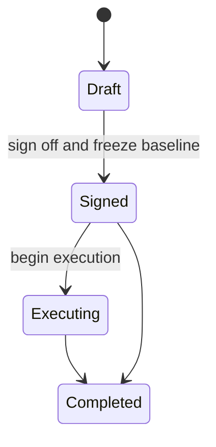
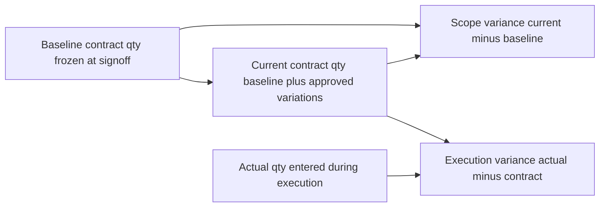
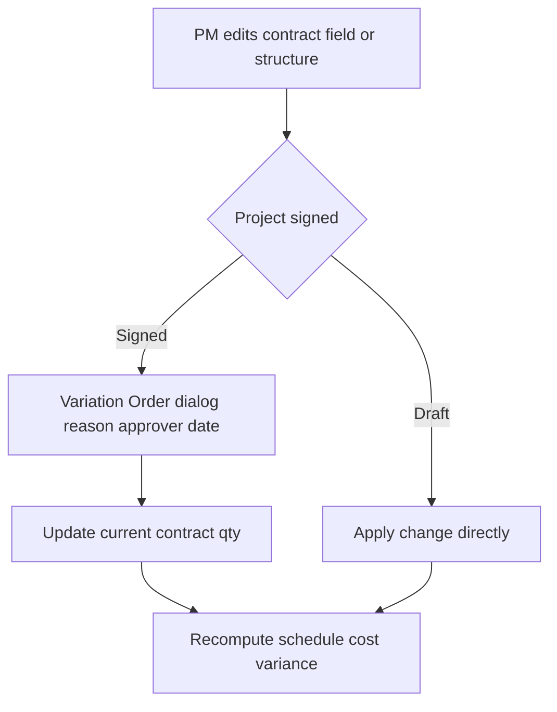

# Advanced Construction PM — Planning → Sign-off → Execution

## Goals
1. **Pre-existing BOQ (post-planning)** — app must work when a full BOQ + tasks already exist & are populated. PM opens a task, adds elements + per-type quantities; element sums **link to / reconcile with existing BOQ leaves** (not only create new ones).
2. **Contract vs Actual quantity** — every task carries a **contract/BOQ qty** (estimated/signed) AND an **actual/executed qty**, with variance.
3. **Formal lifecycle** — Draft → **Sign-off (baseline freeze)** → Execution, with **Variation Orders** for any post-signoff scope/quantity change.

## Decision (confirmed)
**Full formal:** sign-off freezes a baseline snapshot (contract qty, unit price, schedule). After signing, contract quantities are read-only; scope/quantity changes are recorded as Variation Orders (reason, date, approver). Actual quantities tracked separately with live variance vs contract.

---

## Data model

### Project meta (NEW — localStorage key `pm_project_meta`)
```
{
  status: 'draft' | 'signed' | 'executing' | 'completed',
  baseline: {
    signedAt: ISO,
    signedBy: string,
    tasks: { [id]: { quantity, unitPrice, unit, duration, manualStart, name, wbs } }
  } | null,
  variations: [
    { id, date, taskId, type: 'qty'|'price'|'add'|'delete', oldValue, newValue, reason, approver }
  ]
}
```

### Task fields (names kept for back-compat — no destructive migration)
| Field | Meaning | After sign-off |
|---|---|---|
| `quantity` | **Contract / BOQ qty** | read-only (Variation Order) |
| `actualQuantity` | **Actual / executed qty** | editable |
| `unitPrice`, `unit` | price + unit | read-only (VO) |
| `elementColumns`, `elements` | breakdown registry | editable (reconciliation only) |

### Computed (engine output)
- `contractQty` = quantity · `actualQty` = actualQuantity · `price` = unitPrice
- `execVariance` = actualQty − contractQty  (over/under execution)
- `scopeVariance` = contractQty − baseline.tasks[id].quantity  (approved changes vs original)
- `progress` = contractQty > 0 ? actualQty / contractQty : 0
- `elementSum` (linked leaves) = sum of element column values — shown beside frozen contract qty for reconciliation

---

## Engine change — [`GanttEngine.calculate`](ProjectManagerApp/src/utils/GanttEngine.js:107)
- New signature: `calculate(tasks, projectStartDate, projectMeta)`
- [`resolveBoqLinks`](ProjectManagerApp/src/utils/GanttEngine.js:60) gains a **signed** check:
  - **Draft** → linked-leaf `quantity` = live element-column sum (current behavior).
  - **Signed** → linked-leaf `quantity` stays **frozen** (already written into raw at sign-off); `elementSum` computed separately for reconciliation display.
- Add `execVariance`, `scopeVariance`, `baselineQty`, `elementSum` to computed tasks.

### Sign-off action (App.jsx)
1. Run engine to get current computed contract quantities.
2. **Freeze**: write computed contract qty back into each linked leaf's raw `quantity`.
3. Snapshot `baseline.tasks` (qty, price, unit, duration, start, name, wbs).
4. Set `status = 'signed'`, store `signedAt` / `signedBy`.

---

## Diagrams

### Lifecycle


### Quantity & variance model


### Change handling by state


---

## Locking rules
| Area | Draft | Signed / Executing |
|---|---|---|
| Contract qty, unit price, unit | editable | **locked → Variation Order** |
| Add / delete task | free | **Variation Order** |
| Actual qty | editable | editable |
| Element values (breakdown) | editable, drives contract | editable, **reconciliation only** |
| Schedule (start, duration, deps) | editable | editable |
| Element status | editable | editable |

---

## Decision (confirmed)
**Actual quantities — per-task.** Actual qty is one number per task/leaf (`actualQuantity`); elements track completion via their `status` field. Approved — proceeding to implement the plan as written.

---

## Implementation phases (see todo list)
1. projectMeta state + persistence + migration
2. Engine: projectMeta arg, variances, signed freeze, elementSum
3. Sign-off control + baseline snapshot + status lifecycle
4. Locking enforcement (Gantt grid + TaskDetails)
5. Variation Orders (model + intercept + register UI)
6. Pre-existing BOQ linking (link to existing leaf) + reconciliation view
7. UI: contract/actual/variance columns, labels, baseline diff
8. Arabic labels, status badges, build + lint verify
